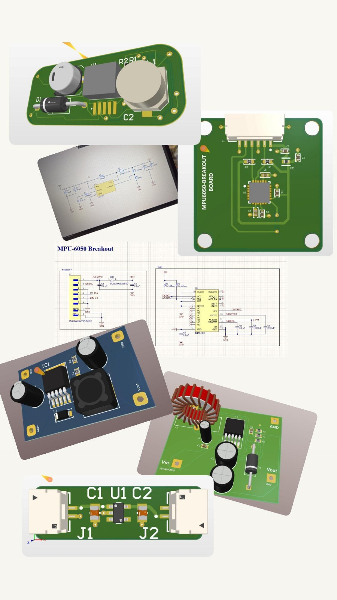

# Basic PCB Circuit Designs

This folder contains small-scale PCB projects for practicing fundamental board-design principles.

## Areas of Focus

- Component placement strategies
- Signal-routing techniques
- Power and ground plane layout
- PCB design rules
- Practical design work in Altium Designer

## Design Tool

- Altium Designer

## Project Images

