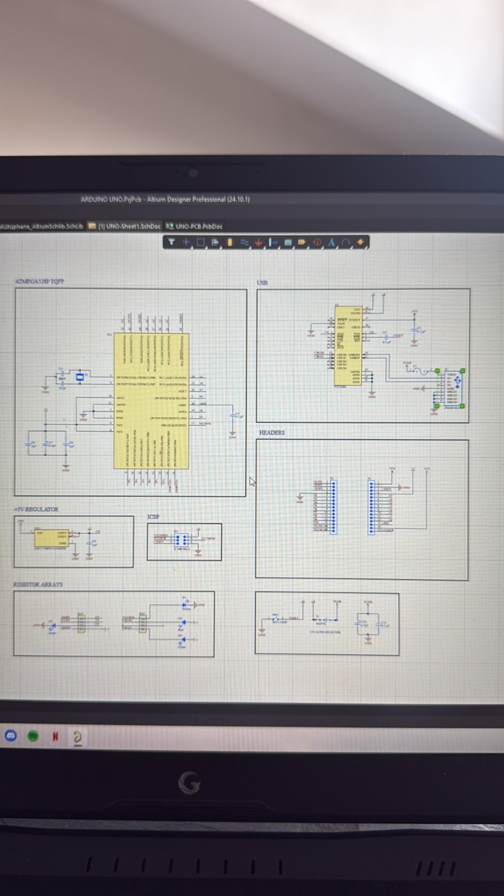
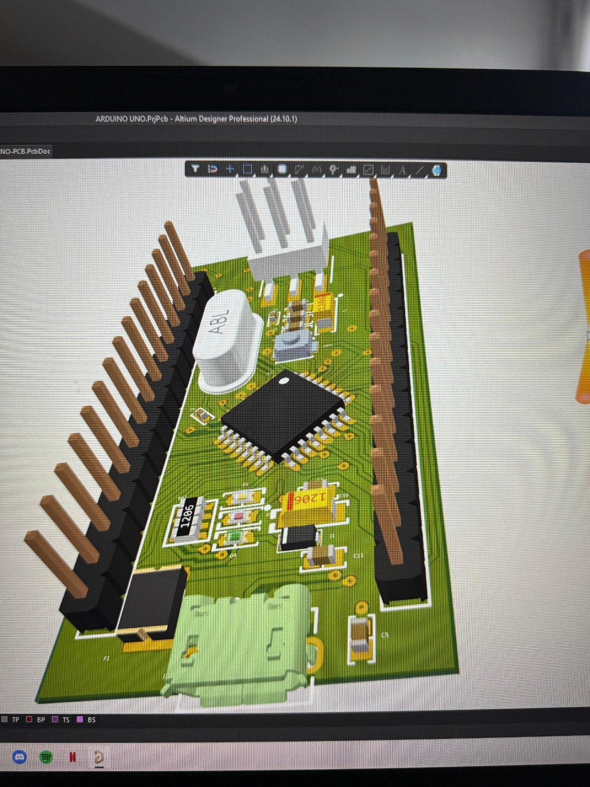
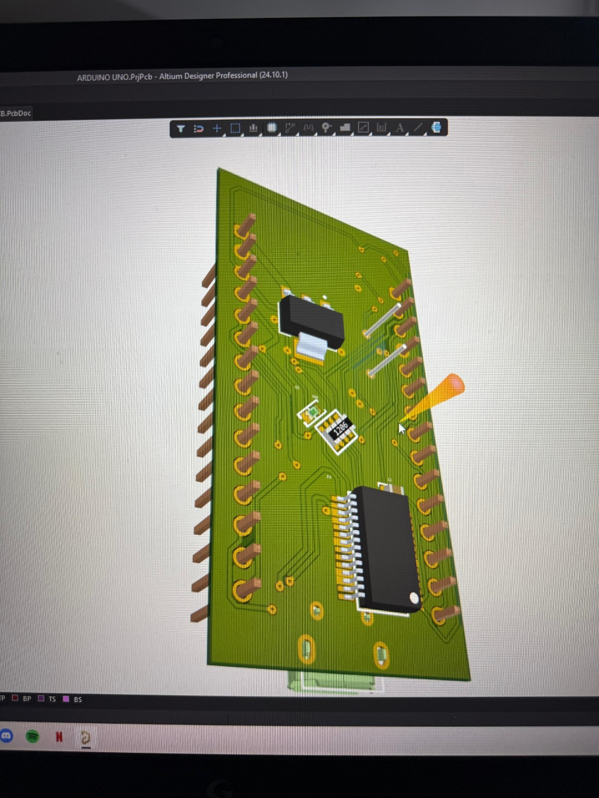

# Arduino Nano PCB Design

This project contains a PCB design for an Arduino Nano-compatible development board.

## Features

- ATmega328P microcontroller
- Arduino Nano-compatible pinout
- A combination of SMD and through-hole (THT) components
- USB-to-serial communication interface
- 5 V voltage regulation

## Design Goals

- Understand the internal architecture of an Arduino Nano
- Practice PCB layout techniques for small boards
- Learn component-placement strategies for compact designs
- Develop practical PCB design skills in Altium Designer

## Tools and References

- Altium Designer
- ATmega328P datasheet
- Arduino Nano reference schematic

## Project Images

