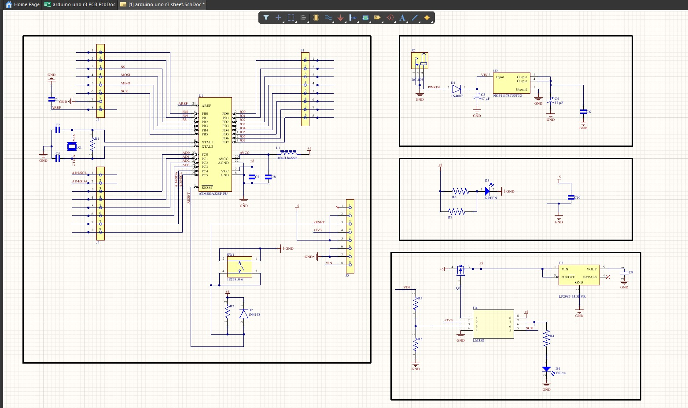
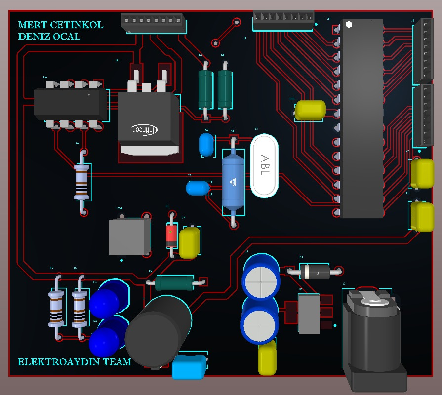
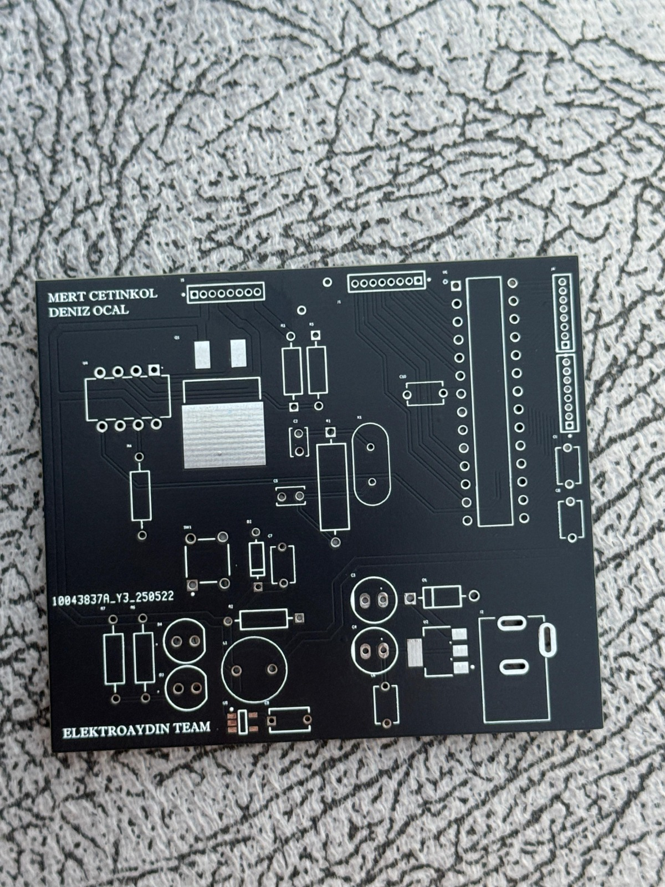

# Arduino Uno THT Version

This project is a through-hole (THT) version of an Arduino Uno-compatible board, designed to make manual assembly and prototyping easier.

> **Note:** This board is designed as a hardware-compatible clone. The ATmega328P microcontroller must be programmed beforehand using another Arduino board or a bootloader programmer. Code cannot be uploaded directly to this board.

## Features

- ATmega328P microcontroller (pre-programmed)
- Arduino Uno-compatible pinout
- Through-hole components for easier soldering
- USB-to-serial communication interface
- 5 V voltage regulation

## Design Goals

- Learn microcontroller-board architecture
- Practice PCB routing and component placement
- Understand power and ground design
- Gain hands-on experience assembling a through-hole board
- Design a functional Arduino-compatible board without on-board programming capability

## Tools and References

- Altium Designer
- ATmega328P datasheet
- Arduino Uno reference schematic

## Project Images

