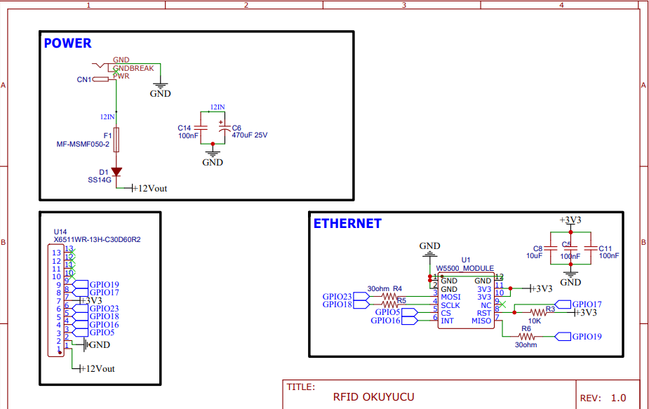
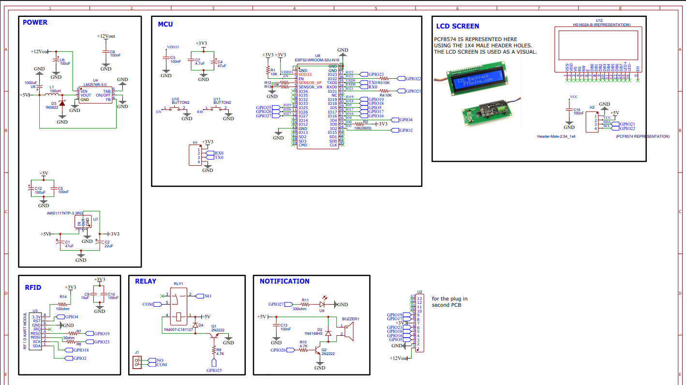

# ESP32-Based RFID Control System

This project contains a hardware design for an ESP32-based RFID control system. It brings together RFID card reading, user notifications, relay control, and status display in a single design.

The design covers power management, microcontroller connections, RFID communication, LCD integration, relay driving, and audio-visual notifications.

## Project Overview

The system is designed to process an RFID card or tag, provide feedback through a display and notification components, and control an external load through a relay output when required.

Its hardware architecture is suited to access control, authorization, smart-lock, card-entry, and similar automation applications.

## Main System Blocks

- **Power**
  - 12 V input
  - 5 V regulation
  - 3.3 V regulation
  - Filtering and bypass capacitors

- **Microcontroller**
  - ESP32-WROOM-32 module
  - UART header
  - Boot and enable buttons
  - Required pull-up and pull-down connections

- **RFID Interface**
  - RFID module connection
  - SPI communication lines
  - 3.3 V supply

- **LCD Interface**
  - I2C-connected LCD
  - PCF8574-based interface representation
  - Text feedback for the user

- **Relay Driver**
  - Relay control output
  - NPN transistor driver
  - Protection diode
  - External-load switching

- **Notifications**
  - Buzzer driver
  - LED indicator output
  - Visual and audible feedback

## Project Goals

- Design ESP32-based hardware
- Integrate an RFID module
- Design the power stage
- Build a relay driver circuit
- Connect an I2C LCD
- Design notification circuits
- Organize a multi-block embedded-system architecture

## Technologies and Components

- ESP32-WROOM-32
- RFID reader module
- I2C LCD interface
- Relay
- 2N2222 transistor
- Buzzer
- LED indicator circuit
- 5 V and 3.3 V regulation
- Schematic and PCB design tools

## Technical Focus

- Creating multiple supply rails from a 12 V input
- Designing suitable power and peripheral connections for the ESP32
- Connecting RFID communication lines to the microcontroller
- Integrating the I2C display interface
- Using a transistor and protection diode in the relay driver
- Providing user notifications through a buzzer and LED
- Organizing the schematic into modular functional blocks

## Potential Applications

- Card-entry systems
- Smart locks
- Authorization and access control
- Embedded automation
- RFID-based user verification

## Project Images

## Possible Extensions

- Complete the PCB layout and prepare it for manufacturing
- Design an enclosure
- Add an authorized-card database
- Add remote management over Wi-Fi or Bluetooth
- Add event logging
- Integrate an electric or magnetic door lock
- Add a real-time clock (RTC)
- Add a mobile app or web interface

## Summary

This modular embedded-system design combines the main hardware blocks required for RFID-based control. It brings power electronics, microcontroller connections, communication interfaces, user notifications, and relay control together in one design.
